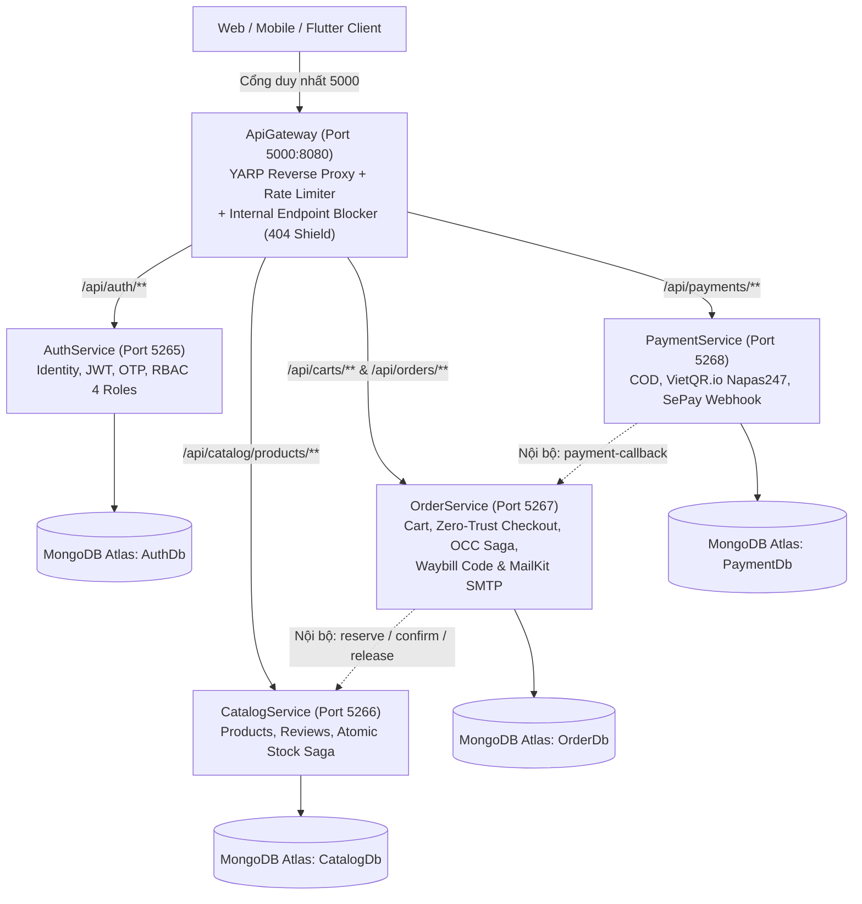

# 👟 Adidas E-Commerce Microservices Platform

Hệ thống Backend Microservices toàn diện cho nền tảng thương mại điện tử chuyên biệt giày thể thao và thời trang **Adidas**. Dự án được xây dựng bằng **.NET 8 Web API**, cổng giao tiếp **YARP API Gateway**, cơ sở dữ liệu phân tán **MongoDB Atlas (Database-per-Service)**, thanh toán **VietQR.io Napas247 + SePay Webhook**, container hóa bằng **Docker Compose** và CI/CD tự động qua **GitHub Actions**.

---

## 🏛️ Kiến Trúc Hệ Thống (System Architecture)



---

## 🚀 Các Microservices Đã Triển Khai

### 1. `ApiGateway` (Cửa ngõ duy nhất & Lá chắn bảo mật Zero-Trust)
- **Công nghệ:** .NET 8, YARP (`Yarp.ReverseProxy`), Fixed-Window Rate Limiter, Aggregated Swagger UI.
- **Port:** `5000:8080`
- **Chức năng chính:**
  - Cổng giao tiếp duy nhất cho Frontend/Mobile, quản lý CORS tập trung và giới hạn tần suất (150 req/phút).
  - **Lá chắn `InternalEndpointBlockerMiddleware`:** Chặn đứng 100% mọi truy cập từ bên ngoài Internet vào các đường dẫn nội bộ chứa `/internal/` (trả về `HTTP 404 Not Found`), đồng thời tự động bóc gỡ header giả mạo `X-Internal-Api-Key`.
  - Giao diện Swagger hợp nhất cho phép tra cứu tài liệu API của cả 4 Microservices phía sau.

### 2. `AuthService` (Quản lý Định danh & Phân quyền RBAC)
- **Công nghệ:** .NET 8, MongoDB Driver, MailKit (Gmail SMTP), BCrypt, Google Auth, JWT Bearer.
- **Port:** `5265:8080` (Database: `AuthDb`)
- **Chức năng chính:**
  - Đăng ký, gửi mã OTP kích hoạt qua Email HTML, đăng nhập cấp cặp Access Token + Refresh Token xoay vòng.
  - Đăng nhập Google OAuth2, quên mật khẩu & đặt lại mật khẩu.
  - Phân quyền 4 vai trò chuẩn chuỗi cung ứng: `Customer`, `Admin`, `LogisticsStaff`, `Driver`.
  - Quản trị người dùng: Cấp phát nhanh nhân sự (`provision-staff`), thu hồi tự động Refresh Token khi đổi Role.

### 3. `CatalogService` (Danh mục Giày & Động cơ Khóa Kho Nguyên Tử)
- **Công nghệ:** .NET 8, MongoDB Driver, BackgroundService TTL Worker, JWT Bearer.
- **Port:** `5266:8080` (Database: `CatalogDb`)
- **Chức năng chính:**
  - Tìm kiếm, bộ lọc đa tiêu chí (Danh mục, Giới tính, Màu, Size còn hàng, Giá, Sale), đánh giá sao & bình luận.
  - Quản trị sản phẩm 2 cấp độ xóa: Xóa mềm (`Soft Delete`), Xóa cứng (`Hard Delete`) và Khôi phục (`Restore`).
  - **Atomic Stock Reservation Engine:** Khóa tồn kho nguyên tử (`reserve`), trừ kho chính thức (`confirm`), hoàn kho (`release`) với cơ chế All-or-Nothing Rollback và `StockReservationExpirationWorker` tự động nhả kho sau 15 phút quá hạn.

### 4. `OrderService` (Giỏ hàng, Checkout Zero-Trust, OCC Saga & Email Vận Đơn)
- **Công nghệ:** .NET 8, MongoDB Driver, Polly v8 Resilience (Retry + Circuit Breaker), MailKit/MimeKit.
- **Port:** `5267:8080` (Database: `OrderDb`)
- **Chức năng chính:**
  - Quản lý giỏ hàng theo từng người dùng (`Carts`).
  - **Zero-Trust Checkout:** Tự động đối chiếu giá và tồn kho trực tiếp từ `CatalogService` (không tin giá từ Client), tạo đơn với mã `ADI-yyyyMMdd-XXXXXX` và giữ chỗ kho 15 phút.
  - **In-Process OCC Saga Orchestrator:** Quản lý vòng đời đơn hàng với kiểm soát đồng thời lạc quan (`Version`), lịch sử `AuditTrail` và xử lý `LatePaymentDetected`.
  - Tự động sinh **Mã vận đơn (`WB-yyyyMMdd-XXXXXX`)** và gửi **Email HTML xác nhận đơn hàng** khi thanh toán thành công.

### 5. `PaymentService` (Thanh toán COD, VietQR.io Napas247 & SePay Webhook)
- **Công nghệ:** .NET 8, MongoDB Driver, Polly v8 Resilience, VietQR.io, SePay.vn Webhook.
- **Port:** `5268:8080` (Database: `PaymentDb`)
- **Chức năng chính:**
  - **Luồng COD (`process-cod`):** Ghi nhận giao dịch COD và gọi callback ngay lập tức sang `OrderService` để duyệt kho, sinh mã vận đơn và gửi Email.
  - **Luồng Online QR (`create-qr`):** Sinh link ảnh mã QR ngân hàng thật theo chuẩn Napas247 (`VietQR.io`) khớp chính xác số tiền và nội dung mã đơn `ADI-...`.
  - **SePay Webhook (`webhook/sepay`):** Nhận thông báo biến động số dư thời gian thực từ SePay.vn, chuẩn hóa mã đơn bằng Regex (hỗ trợ cả khi ngân hàng xóa dấu `-`), chống trùng lặp giao dịch (`ux_sePayTransactionId`) và tự động duyệt đơn.

---

## 📋 Bảng Tổng Hợp Các API Endpoints Chính

### A. Public Endpoints (Truy cập qua `ApiGateway` - Port `5000`)

| Dịch vụ đích | Phương thức | Đường dẫn qua Gateway | Quyền | Mô tả |
| :--- | :--- | :--- | :--- | :--- |
| **Auth** | `POST` | `/api/auth/register` | Public | Đăng ký tài khoản mới & nhận OTP qua Email |
| **Auth** | `POST` | `/api/auth/login` | Public | Đăng nhập nhận Access Token & Refresh Token |
| **Auth** | `POST` | `/api/auth/users/provision-staff` | Admin | Cấp phát tài khoản `LogisticsStaff` / `Driver` |
| **Catalog** | `GET` | `/api/catalog/products` | Public | Danh sách giày kèm bộ lọc, tìm kiếm, phân trang |
| **Catalog** | `GET` | `/api/catalog/products/{id}` | Public | Chi tiết sản phẩm & tồn kho từng size |
| **Catalog** | `POST/PUT/DELETE` | `/api/catalog/products` | Admin | Thêm, cập nhật, xóa mềm/xóa cứng sản phẩm |
| **Order** | `GET/POST/PUT/DELETE` | `/api/carts/items` | Authenticated | Xem giỏ hàng, thêm/sửa/xóa đôi giày trong giỏ |
| **Order** | `POST` | `/api/orders/checkout` | Customer / Admin | Đặt hàng Zero-Trust & khóa kho tạm 15 phút |
| **Order** | `GET` | `/api/orders/my-orders` | Authenticated | Danh sách đơn hàng của tôi |
| **Order** | `GET` | `/api/orders/{id}/timeline` | Owner / Staff / Admin | Xem lịch sử trạng thái Saga (`AuditTrail`) |
| **Order** | `POST` | `/api/orders/{id}/cancel` | Owner / Admin | Hủy đơn hàng & hoàn trả tồn kho ngay lập tức |
| **Payment** | `POST` | `/api/payments/process-cod` | Customer / Admin | Chọn thanh toán COD -> Duyệt đơn & gửi Email ngay |
| **Payment** | `POST` | `/api/payments/create-qr` | Customer / Admin | Sinh mã QR chuyển khoản chuẩn Napas247 (`VietQR.io`) |
| **Payment** | `POST` | `/api/payments/webhook/sepay` | SePay (`Apikey`) | Nhận biến động số dư tự động từ SePay.vn |
| **Payment** | `GET` | `/api/payments/order/{orderId}` | Authenticated | Tra cứu lịch sử giao dịch thanh toán của đơn |

### B. Internal Endpoints (Chỉ gọi nội bộ Service-to-Service, **BỊ CHẶN 404** tại Gateway)

| Dịch vụ đích | Phương thức | Đường dẫn nội bộ | Đơn vị gọi | Mô tả |
| :--- | :--- | :--- | :--- | :--- |
| **Catalog** | `POST` | `/api/catalog/internal/stock/reserve` | `OrderService` | Giữ chỗ tồn kho nguyên tử trong 15 phút |
| **Catalog** | `POST` | `/api/catalog/internal/stock/confirm` | `OrderService` | Xuất kho chính thức sau khi xác nhận thanh toán |
| **Catalog** | `POST` | `/api/catalog/internal/stock/release` | `OrderService` | Nhả kho khi hủy đơn hoặc hết hạn giữ hàng |
| **Order** | `POST` | `/api/orders/internal/payment-callback` | `PaymentService` | Thông báo kết quả thanh toán -> Sinh vận đơn & gửi Email |

---

## 🛠️ Hướng Dẫn Khởi Chạy Dự Án

### 1. Cấu hình biến môi trường (`.env`)
Sao chép file `.env.example` thành `.env` tại thư mục gốc dự án và điền các thông số kết nối MongoDB Atlas, JWT Secret, Gmail AppPassword, VietQR và SePay API Key:
```bash
cp .env.example .env
```

### 2. Chạy toàn bộ hệ thống bằng Docker Compose
```bash
docker compose up --build -d
```

### 3. Hoặc chạy từng dịch vụ khi phát triển (Local Development)
- **ApiGateway:** `http://localhost:5000/swagger`
- **AuthService:** `http://localhost:5265/swagger`
- **CatalogService:** `http://localhost:5266/swagger`
- **OrderService:** `http://localhost:5267/swagger`
- **PaymentService:** `http://localhost:5268/swagger`

### 4. Chạy bộ Unit & Integration Tests
```bash
dotnet test OrderService.Models.Tests/OrderService.Models.Tests.csproj -c Release
dotnet test OrderService.Tests/OrderService.Tests.csproj -c Release
```
