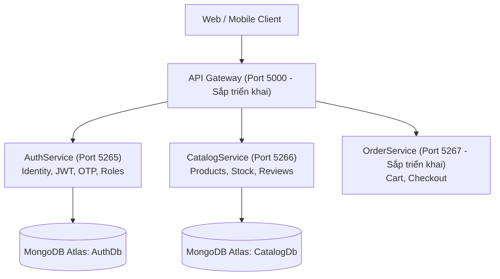

# 👟 Adidas E-Commerce Microservices

Hệ thống Backend Microservices cho nền tảng thương mại điện tử chuyên biệt giày thể thao và thời trang Adidas. Dự án được xây dựng bằng **.NET 8 Web API**, cơ sở dữ liệu **MongoDB Atlas**, container hóa bằng **Docker Compose** và CI/CD tự động bằng **GitHub Actions**.

---

## 🏛️ Kiến trúc hệ thống (Architecture)



---

## 🚀 Các dịch vụ đã triển khai (Services)

### 1. `AuthService` (Quản lý Định danh & Phân quyền)
- **Công nghệ:** .NET 8, MongoDB Driver, MailKit (Google SMTP), BCrypt, JWT Bearer.
- **Port:** `5265:8080` (Database: `AuthDb`)
- **Chức năng chính:**
  - Đăng ký tài khoản, gửi OTP kích hoạt qua Email HTML.
  - Đăng nhập cấp cặp Access Token (15 phút) + Refresh Token xoay vòng (30 ngày).
  - Quản lý phiên đăng xuất thiết bị đơn lẻ hoặc toàn bộ thiết bị.
  - Quên mật khẩu & đổi mật khẩu an toàn.
  - Đăng nhập xác thực với Google ID Token.
  - Phân quyền theo Role: `Customer` (mặc định) và `Admin`.

### 2. `CatalogService` (Quản lý Danh mục & Sản phẩm giày)
- **Công nghệ:** .NET 8, MongoDB Driver, JWT Bearer, Swagger UI.
- **Port:** `5266:8080` (Database: `CatalogDb`)
- **Chức năng chính:**
  - Tra cứu sản phẩm đa tiêu chí: Từ khóa, Dòng giày (Running, Originals, Football...), Giới tính, Màu sắc, Size còn hàng, Khoảng giá, Giảm giá (Sale), Nhãn nổi bật (Best Seller, New Arrival, Hot Sale).
  - Sắp xếp và phân trang linh hoạt.
  - Bảng size chi tiết kèm số lượng tồn kho từng cỡ giày (Size 36 - 45).
  - Đánh giá sản phẩm (1 - 5 sao) và nhận xét của khách hàng kèm tự động tính điểm trung bình.
  - Quản trị viên (Admin): Thêm, Sửa, Xóa mềm (Ẩn khỏi cửa hàng), Xóa cứng (Vĩnh viễn khỏi Database) và Khôi phục sản phẩm (`Restore`).
  - Tự động Seeder 6 mẫu giày Adidas thật kèm hình ảnh chuẩn khi khởi chạy lần đầu.

---

## 📋 API Endpoints của CatalogService

| Phương thức | Đường dẫn | Quyền | Mô tả |
| :--- | :--- | :--- | :--- |
| `GET` | `/api/catalog/products` | Public | Danh sách sản phẩm kèm bộ lọc đa năng |
| `GET` | `/api/catalog/products/{id}` | Public | Chi tiết sản phẩm theo ID (hỗ trợ `includeInactive=true`) |
| `GET` | `/api/catalog/filters` | Public | Metadata các bộ lọc (Danh mục, màu sắc, size, giá min/max) |
| `POST` | `/api/catalog/products/{id}/reviews` | Customer / Admin | Gửi đánh giá sao & nhận xét |
| `POST` | `/api/catalog/products` | Admin | Thêm sản phẩm mới (Mặc định `isActive = true`) |
| `PUT` | `/api/catalog/products/{id}` | Admin | Cập nhật thông tin, giá, size tồn kho, trạng thái bán |
| `DELETE` | `/api/catalog/products/{id}` | Admin | Xóa mềm ẩn sản phẩm (Thêm `hardDelete=true` để xóa vĩnh viễn) |
| `PATCH` | `/api/catalog/products/{id}/restore` | Admin | Khôi phục mở bán lại sản phẩm đã bị ẩn |

---

## 🛠️ Hướng dẫn khởi chạy cục bộ (Local Development)

### Yêu cầu:
- .NET 8 SDK
- Docker & Docker Compose (tùy chọn)
- MongoDB Atlas Connection String

### Chạy từng dịch vụ:
```bash
# Chạy AuthService
cd AuthService
dotnet run

# Chạy CatalogService
cd CatalogService
dotnet run
```

### Chạy đồng bộ qua Docker Compose:
```bash
docker compose up --build -d
```
