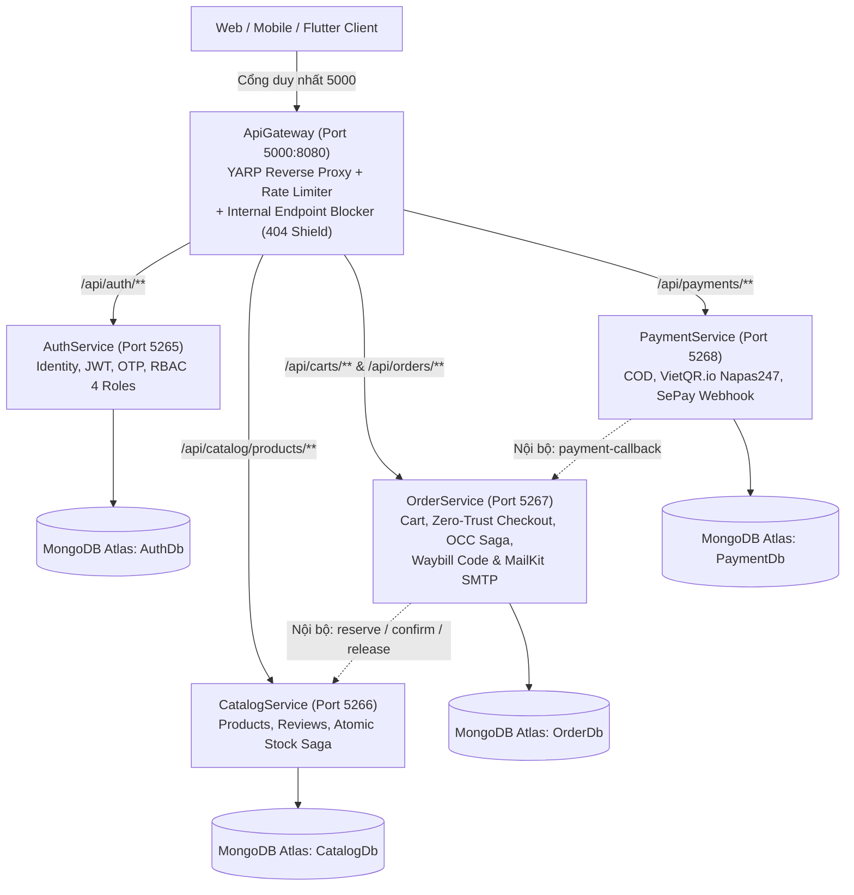

# 👟 Adidas E-Commerce Microservices Platform

Hệ thống Backend Microservices toàn diện cho nền tảng thương mại điện tử chuyên biệt giày thể thao và thời trang **Adidas**. Dự án được xây dựng bằng **.NET 8 Web API**, cổng giao tiếp **YARP API Gateway**, cơ sở dữ liệu phân tán **MongoDB Atlas (Database-per-Service)**, thanh toán **VietQR.io Napas247 + SePay Webhook**, container hóa bằng **Docker Compose** và CI/CD tự động qua **GitHub Actions**.

---

## 🏛️ Kiến Trúc Hệ Thống (System Architecture)



---

## 🚀 Các Microservices Đã Triển Khai

### 1. `ApiGateway` (Cửa ngõ duy nhất & Lá chắn bảo mật Zero-Trust)
- **Công nghệ:** .NET 8, YARP (`Yarp.ReverseProxy`), Fixed-Window Rate Limiter, Aggregated Swagger UI.
- **Port:** `5000:8080`
- **Chức năng chính:**
  - Cổng giao tiếp duy nhất cho Frontend/Mobile, quản lý CORS tập trung và giới hạn tần suất (150 req/phút).
  - **Lá chắn `InternalEndpointBlockerMiddleware`:** Chặn đứng 100% mọi truy cập từ bên ngoài Internet vào các đường dẫn nội bộ chứa `/internal/` (trả về `HTTP 404 Not Found`), đồng thời tự động bóc gỡ header giả mạo `X-Internal-Api-Key`.
  - Giao diện Swagger hợp nhất cho phép tra cứu tài liệu API của cả 4 Microservices phía sau.

### 2. `AuthService` (Quản lý Định danh & Phân quyền RBAC)
- **Công nghệ:** .NET 8, MongoDB Driver, MailKit (Gmail SMTP), BCrypt, Google Auth, JWT Bearer.
- **Port:** `5265:8080` (Database: `AuthDb`)
- **Chức năng chính:**
  - Đăng ký, gửi mã OTP kích hoạt qua Email HTML, đăng nhập cấp cặp Access Token + Refresh Token xoay vòng.
  - Đăng nhập Google OAuth2, quên mật khẩu & đặt lại mật khẩu.
  - Phân quyền 4 vai trò chuẩn chuỗi cung ứng: `Customer`, `Admin`, `LogisticsStaff`, `Driver`.
  - Quản trị người dùng: Cấp phát nhanh nhân sự (`provision-staff`), thu hồi tự động Refresh Token khi đổi Role.

### 3. `CatalogService` (Danh mục Giày & Động cơ Khóa Kho Nguyên Tử)
- **Công nghệ:** .NET 8, MongoDB Driver, BackgroundService TTL Worker, JWT Bearer.
- **Port:** `5266:8080` (Database: `CatalogDb`)
- **Chức năng chính:**
  - Tìm kiếm, bộ lọc đa tiêu chí (Danh mục, Giới tính, Màu, Size còn hàng, Giá, Sale), đánh giá sao & bình luận.
  - Quản trị sản phẩm 2 cấp độ xóa: Xóa mềm (`Soft Delete`), Xóa cứng (`Hard Delete`) và Khôi phục (`Restore`).
  - **Atomic Stock Reservation Engine:** Khóa tồn kho nguyên tử (`reserve`), trừ kho chính thức (`confirm`), hoàn kho (`release`) với cơ chế All-or-Nothing Rollback và `StockReservationExpirationWorker` tự động nhả kho sau 15 phút quá hạn.

### 4. `OrderService` (Giỏ hàng, Checkout Zero-Trust, OCC Saga & Email Vận Đơn)
- **Công nghệ:** .NET 8, MongoDB Driver, Polly v8 Resilience (Retry + Circuit Breaker), MailKit/MimeKit.
- **Port:** `5267:8080` (Database: `OrderDb`)
- **Chức năng chính:**
  - Quản lý giỏ hàng theo từng người dùng (`Carts`).
  - **Zero-Trust Checkout:** Tự động đối chiếu giá và tồn kho trực tiếp từ `CatalogService` (không tin giá từ Client), tạo đơn với mã `ADI-yyyyMMdd-XXXXXX` và giữ chỗ kho 15 phút.
  - **In-Process OCC Saga Orchestrator:** Quản lý vòng đời đơn hàng với kiểm soát đồng thời lạc quan (`Version`), lịch sử `AuditTrail` và xử lý `LatePaymentDetected`.
  - Tự động sinh **Mã vận đơn (`WB-yyyyMMdd-XXXXXX`)** và gửi **Email HTML xác nhận đơn hàng** khi thanh toán thành công.

### 5. `PaymentService` (Thanh toán COD, VietQR.io Napas247 & SePay Webhook)
- **Công nghệ:** .NET 8, MongoDB Driver, Polly v8 Resilience, VietQR.io, SePay.vn Webhook.
- **Port:** `5268:8080` (Database: `PaymentDb`)
- **Chức năng chính:**
  - **Luồng COD (`process-cod`):** Ghi nhận giao dịch COD và gọi callback ngay lập tức sang `OrderService` để duyệt kho, sinh mã vận đơn và gửi Email.
  - **Luồng Online QR (`create-qr`):** Sinh link ảnh mã QR ngân hàng thật theo chuẩn Napas247 (`VietQR.io`) khớp chính xác số tiền và nội dung mã đơn `ADI-...`.
  - **SePay Webhook (`webhook/sepay`):** Nhận thông báo biến động số dư thời gian thực từ SePay.vn, chuẩn hóa mã đơn bằng Regex (hỗ trợ cả khi ngân hàng xóa dấu `-`), chống trùng lặp giao dịch (`ux_sePayTransactionId`) và tự động duyệt đơn.

---

## 📋 Danh Mục Toàn Diện 100% API Endpoints (42 Endpoints)

> 💡 **Dành cho Lập trình viên Frontend:** Toàn bộ API công khai đều gọi qua cổng duy nhất **`http://localhost:5000`**.

### 1. `AuthService` – Xác thực, Tài khoản & Phân quyền (15 APIs)

| Phương thức | Đường dẫn qua Gateway (Port 5000) | Quyền yêu cầu | Mô tả chức năng |
| :--- | :--- | :--- | :--- |
| `POST` | `/api/auth/register` | Public | Đăng ký tài khoản người dùng mới (gửi OTP kích hoạt qua Email) |
| `POST` | `/api/auth/verify-otp` | Public | Xác thực OTP kích hoạt tài khoản |
| `POST` | `/api/auth/resend-otp` | Public | Gửi lại mã OTP mới khi hết hạn (cooldown 60s) |
| `POST` | `/api/auth/login` | Public | Đăng nhập bằng Email/Password, nhận Access Token & Refresh Token |
| `POST` | `/api/auth/google` | Public | Đăng nhập nhanh bằng Google ID Token (tự tạo tài khoản nếu mới) |
| `POST` | `/api/auth/refresh-token` | Public | Làm mới Access Token bằng Refresh Token (xoay vòng token) |
| `POST` | `/api/auth/logout` | Authenticated | Đăng xuất thu hồi Refresh Token trên thiết bị hiện tại |
| `POST` | `/api/auth/logout-all` | Authenticated | Đăng xuất toàn bộ các thiết bị (thu hồi tất cả Refresh Token) |
| `POST` | `/api/auth/forgot-password` | Public | Yêu cầu quên mật khẩu (gửi OTP xác nhận qua Email) |
| `POST` | `/api/auth/reset-password` | Public | Đặt lại mật khẩu mới bằng mã OTP đã nhận |
| `POST` | `/api/auth/change-password` | Authenticated | Đổi mật khẩu tài khoản đang đăng nhập |
| `GET` | `/api/auth/me` | Authenticated | Lấy thông tin hồ sơ của tài khoản đang đăng nhập |
| `GET` | `/api/auth/users` | Admin | Quản trị danh sách người dùng (lọc theo Role, từ khóa) |
| `PATCH` | `/api/auth/users/{id}/role` | Admin | Cập nhật phân quyền Role cho người dùng (tự thu hồi token cũ) |
| `POST` | `/api/auth/users/provision-staff` | Admin | Cấp phát tài khoản `LogisticsStaff` hoặc `Driver` đã kích hoạt |

---

### 2. `CatalogService` – Sản phẩm, Đánh giá & Kho (14 APIs)

#### A. Public & Admin APIs (Gọi qua Gateway Port 5000 - 8 APIs)
| Phương thức | Đường dẫn qua Gateway (Port 5000) | Quyền yêu cầu | Mô tả chức năng |
| :--- | :--- | :--- | :--- |
| `GET` | `/api/catalog/products` | Public | Danh sách sản phẩm kèm bộ lọc (danh mục, giới tính, màu, size, giá, sale), tìm kiếm, sắp xếp và phân trang |
| `GET` | `/api/catalog/products/{id}` | Public | Chi tiết sản phẩm, đánh giá và tồn kho từng cỡ giày (hỗ trợ `?includeInactive=true`) |
| `GET` | `/api/catalog/filters` | Public | Metadata các bộ lọc hỗ trợ FE dựng UI (danh mục, màu, size, giá min/max) |
| `POST` | `/api/catalog/products/{id}/reviews` | Customer / Admin | Gửi đánh giá sao (1-5) & nhận xét cho sản phẩm (tự tính điểm TB) |
| `POST` | `/api/catalog/products` | Admin | Tạo sản phẩm mới kèm bảng tồn kho các size |
| `PUT` | `/api/catalog/products/{id}` | Admin | Cập nhật thông tin, giá, size, khuyến mãi của sản phẩm |
| `DELETE` | `/api/catalog/products/{id}` | Admin | Xóa mềm ẩn sản phẩm (Thêm `?hardDelete=true` để xóa vĩnh viễn) |
| `PATCH` | `/api/catalog/products/{id}/restore` | Admin | Khôi phục mở bán lại sản phẩm đã bị ẩn |

#### B. Internal Stock APIs (Chỉ gọi nội bộ Service-to-Service, **BỊ CHẶN 404 TẠI GATEWAY** - 6 APIs)
| Phương thức | Đường dẫn nội bộ | Đơn vị gọi | Mô tả chức năng |
| :--- | :--- | :--- | :--- |
| `POST` | `/api/catalog/internal/stock/reserve` | `OrderService` | Khóa tồn kho nguyên tử theo đơn hàng trong 15 phút |
| `POST` | `/api/catalog/internal/stock/confirm` | `OrderService` | Trừ tồn kho chính thức sau khi thanh toán thành công |
| `POST` | `/api/catalog/internal/stock/release` | `OrderService` | Nhả kho hoàn trả số lượng khi hủy đơn hoặc hết hạn |
| `GET` | `/api/catalog/internal/stock/reservations/{orderId}` | Nội bộ / Diagnostic | Tra cứu phiên giữ hàng của một đơn hàng cụ thể |
| `GET` | `/api/catalog/internal/stock/reservations` | Nội bộ / Diagnostic | Danh sách các phiên giữ hàng tồn kho (`Reserved`, `Confirmed`, `Released`, `Expired`) |
| `POST` | `/api/catalog/internal/stock/cleanup-expired` | Worker / Cron | Thủ công kích hoạt dọn dẹp các phiên giữ hàng quá hạn 15 phút |

---

### 3. `OrderService` – Giỏ hàng, Đơn hàng & Saga (12 APIs)

#### A. Carts Controller (Gọi qua Gateway Port 5000 - 5 APIs)
| Phương thức | Đường dẫn qua Gateway (Port 5000) | Quyền yêu cầu | Mô tả chức năng |
| :--- | :--- | :--- | :--- |
| `GET` | `/api/carts/my-cart` | Authenticated | Lấy giỏ hàng của người dùng hiện tại |
| `POST` | `/api/carts/items` | Authenticated | Thêm sản phẩm và size giày vào giỏ hàng |
| `PUT` | `/api/carts/items/{productId}/{size}` | Authenticated | Cập nhật số lượng của một đôi giày trong giỏ |
| `DELETE` | `/api/carts/items/{productId}/{size}` | Authenticated | Xóa một đôi giày ra khỏi giỏ hàng |
| `DELETE` | `/api/carts/clear` | Authenticated | Xóa rỗng toàn bộ giỏ hàng |

#### B. Orders Controller (Gọi qua Gateway Port 5000 - 6 APIs)
| Phương thức | Đường dẫn qua Gateway (Port 5000) | Quyền yêu cầu | Mô tả chức năng |
| :--- | :--- | :--- | :--- |
| `POST` | `/api/orders/checkout` | Customer / Admin | Đặt hàng Zero-Trust (tự lấy giỏ hoặc mua ngay), khóa kho 15p, sinh mã `ADI-yyyyMMdd-XXXXXX` |
| `GET` | `/api/orders/my-orders` | Customer / Admin | Danh sách đơn hàng cá nhân của tài khoản đang đăng nhập |
| `GET` | `/api/orders` | Admin / LogisticsStaff | Danh sách toàn bộ đơn hàng hệ thống (quản lý vận hành) |
| `GET` | `/api/orders/{id}` | Owner / Staff / Admin | Xem thông tin chi tiết một đơn hàng kèm địa chỉ giao và danh sách sản phẩm |
| `GET` | `/api/orders/{id}/timeline` | Owner / Staff / Admin | Xem lịch sử dòng thời gian chuyển trạng thái Saga (`AuditTrail`) |
| `POST` | `/api/orders/{id}/cancel` | Customer / Admin | Hủy đơn hàng và tự động nhả tồn kho ngay lập tức |

#### C. Internal Orders Controller (Gọi nội bộ, **BỊ CHẶN 404 TẠI GATEWAY** - 1 API)
| Phương thức | Đường dẫn nội bộ | Đơn vị gọi | Mô tả chức năng |
| :--- | :--- | :--- | :--- |
| `POST` | `/api/orders/internal/payment-callback` | `PaymentService` | Ghi nhận kết quả thanh toán -> Duyệt kho -> Cấp mã vận đơn `WB-...` & gửi Email |

---

### 4. `PaymentService` – Thanh toán COD, VietQR & SePay Webhook (4 APIs)

| Phương thức | Đường dẫn qua Gateway (Port 5000) | Quyền yêu cầu | Mô tả chức năng |
| :--- | :--- | :--- | :--- |
| `POST` | `/api/payments/process-cod` | Customer / Admin | Chọn thanh toán khi nhận hàng (COD) -> Tự động duyệt đơn & gửi Email ngay |
| `POST` | `/api/payments/create-qr` | Customer / Admin | Sinh link ảnh mã QR Napas247 thật (`VietQR.io`) với đúng STK, số tiền và mã `ADI-...` |
| `POST` | `/api/payments/webhook/sepay` | Public / SePay Key | Webhook nhận biến động số dư tự động từ SePay.vn khi khách chuyển tiền thật |
| `GET` | `/api/payments/order/{orderId}` | Authenticated | Tra cứu toàn bộ lịch sử các giao dịch thanh toán của một đơn hàng |

---

### 5. `ApiGateway` – Cửa ngõ (1 API)

| Phương thức | Đường dẫn | Quyền yêu cầu | Mô tả chức năng |
| :--- | :--- | :--- | :--- |
| `GET` | `http://localhost:5000/health` | Public | Kiểm tra trạng thái hoạt động của Gateway và danh sách các Microservices |

---

## 🛠️ Hướng Dẫn Khởi Chạy Dự Án

### 1. Cấu hình biến môi trường (`.env`)
Sao chép file `.env.example` thành `.env` tại thư mục gốc dự án và điền các thông số kết nối MongoDB Atlas, JWT Secret, Gmail AppPassword, VietQR và SePay API Key:
```bash
cp .env.example .env
```

### 2. Chạy toàn bộ hệ thống bằng Docker Compose
```bash
docker compose up --build -d
```

### 3. Hoặc chạy từng dịch vụ khi phát triển (Local Development)
- **ApiGateway:** `http://localhost:5000/swagger`
- **AuthService:** `http://localhost:5265/swagger`
- **CatalogService:** `http://localhost:5266/swagger`
- **OrderService:** `http://localhost:5267/swagger`
- **PaymentService:** `http://localhost:5268/swagger`

### 4. Chạy bộ Unit & Integration Tests
```bash
dotnet test OrderService.Models.Tests/OrderService.Models.Tests.csproj -c Release
dotnet test OrderService.Tests/OrderService.Tests.csproj -c Release
```
